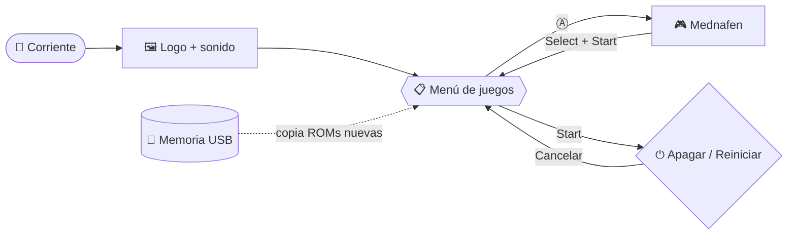
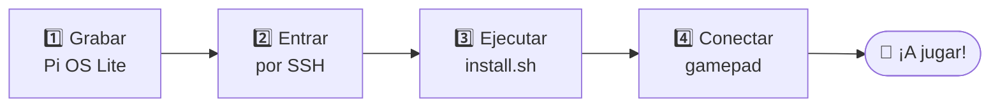

<div align="center">

# 🎮 BIT-BOY

### Consola retro con Raspberry Pi 3 B+

*Enchufa, enciende y juega. Sin teclado, sin mouse, sin escritorio.*


[Qué hace](#-qué-hace) •
[Materiales](#-materiales) •
[Instalación](#-instalación-automática) •
[Controles](#-cómo-se-juega) •
[Problemas](#-solución-de-problemas) •
[Contenido](#-contenido-del-repositorio)

</div>

---

## 📖 Acerca del proyecto

**BIT-BOY** es una consola de videojuegos retro que emula **NES, SNES y Game Boy Advance**
con [Mednafen](https://mednafen.github.io/documentation). Arranca sola al conectar la
corriente, muestra un logo con sonido, lista los juegos y se controla **solo con un
gamepad** USB tipo Xbox.

> [!NOTE]
> Proyecto final de *Fundamentos de Sistemas Embebidos* — UNAM, Facultad de Ingeniería.
> Opción **5.4 "Consola de videojuegos Retro"**.

| | |
| :-- | :-- |
| 👩‍💻 **Equipo** | Daniela Martínez · Judith Mora · Luis Hernández |
| 📜 **Licencia** | MIT (ver [`LICENSE`](LICENSE)) |
| 🎬 **Video demostrativo** | --- |
| 📦 **Repositorio** | [`Consola Retro`](https://github.com/DanyMB2326/consola-retro-FSEm) |

---

## ✨ Qué hace

<table>
<tr>
<td width="50%" valign="top">

### 🚀 Arranque tipo consola
Logo BIT-BOY con tono de arranque, **sin texto de consola visible**. Un servicio de
systemd abre el lanzador directo, sin escritorio.

</td>
<td width="50%" valign="top">

### 🗂️ Menú por sistema
Pestañas **Todos / NES / SNES / GBA**. Se navega con la cruceta, la palanca y los
botones del gamepad.

</td>
</tr>
<tr>
<td width="50%" valign="top">

### 💾 ROMs por USB
Al conectar una memoria USB, copia las ROMs nuevas **sin duplicados** (compara MD5),
incluso mientras hay un juego abierto.

</td>
<td width="50%" valign="top">

### ⏻ Salida y apagado seguro
<kbd>Select</kbd> + <kbd>Start</kbd> cierra el juego. <kbd>Start</kbd> en el menú abre
**Apagar / Reiniciar / Cancelar**.

</td>
</tr>
</table>

### 🔄 Flujo de la consola



---

## 🧰 Materiales

| | Componente | Detalle |
| :-: | :-- | :-- |
| 🍓 | **Raspberry Pi 3 B+** | Placa principal |
| 💽 | **microSD** | 8 GB o más |
| 🔋 | **Fuente de alimentación** | 5 V y 2.5 A |
| 🎮 | **Gamepad** | GameSir K1 o cualquier gamepad USB tipo Xbox |
| 📺 | **Pantalla + cable HDMI** | La pantalla debe tener audio |
| 💾 | **Memoria USB** | Para cargar ROMs |
| 🌀 | **Carcasa con ventilador** | Mantiene fría la Raspberry en sesiones largas |

> [!TIP]
> **🌀 Enfriamiento:** la consola va dentro de una carcasa con ventilador. Así puede
> estar encendida mucho tiempo sin calentarse ni bajar su rendimiento.

> [!WARNING]
> Una fuente débil hace que el gamepad se desconecte solo. Usa una fuente de **2.5 A reales**.

---

## ⚙️ Instalación automática



**1. Prepara la microSD.** Instala **Raspberry Pi OS Lite** con Raspberry Pi Imager. Crea tu usuario y activa SSH.

**2. Conéctate.** Enciende la Raspberry con internet y entra por SSH.

**3. Descarga e instala:**

```bash
sudo apt-get install -y git
git clone https://github.com/DanyMB2326/consola-retro-FSEm
cd consola-retro-FSEm/src
./install.sh
```

**4. Conecta el gamepad** y reinicia si hace falta. La consola arranca sola. 🎉

<details>
<summary>🔍 <b>¿Qué configura exactamente <code>install.sh</code>?</b></summary>

<br>

| Paso | Qué hace |
| :-- | :-- |
| 📦 Paquetes | Instala Mednafen, pygame y dependencias |
| 📺 Video | Configura la salida y fija Mesa 25.0.7 (ver [problemas](#-solución-de-problemas)) |
| 🔊 Audio | Copia `asound.conf` para el sonido por HDMI |
| 🤫 Arranque silencioso | Oculta los mensajes de arranque |
| 🔐 Permisos | Ajusta los accesos al gamepad, el video y las memorias USB |
| 🧩 Servicio | Instala `retro.service` y lo activa |
| 🔁 Reinicio | Reinicia al terminar |

> [!TIP]
> El script se puede ejecutar varias veces sin problema.
> Usa `./install.sh --no-reboot` si no quieres que reinicie al terminar.

</details>

### 🕹️ Mapeo del gamepad (solo una vez)

> [!IMPORTANT]
> Si el paquete trae `src/mednafen.cfg`, el instalador lo usa y **puedes saltarte este paso**.

Mednafen crea su archivo de configuración la primera vez que abre un juego. Después de
instalar y reiniciar:

- [ ] Abre cualquier juego desde el menú y sal con <kbd>Select</kbd> + <kbd>Start</kbd>.
- [ ] Ejecuta el asistente y asigna <kbd>A</kbd> <kbd>B</kbd> <kbd>X</kbd> <kbd>Y</kbd> <kbd>L</kbd> <kbd>R</kbd> <kbd>Select</kbd> <kbd>Start</kbd> y la cruceta en NES, SNES y GBA:
  ```bash
  cd REPOSITORIO/src && ./mapear_control.sh
  ```
- [ ] Comprueba que quedó guardado:
  ```bash
  grep -E 'gamepad\.(a|b|x|y) ' ~/.mednafen/mednafen.cfg | grep -E 'nes|gba'
  ```

<details>
<summary>🎮 <b>¿Usas otro gamepad que no es el GameSir K1?</b></summary>

<br>

Cambia el identificador `ID` al inicio de `mapear_control.sh`. Lo encuentras con:

```bash
grep -i "unique id" ~/.mednafen/*.log
```

o en el registro de Mednafen (`~/mednafen_ultimo.log`).

</details>

---

## 🎮 Cómo se juega

<div align="center">

| Acción | En el menú | En el juego |
| :-- | :-: | :-: |
| Moverse | ✚ Cruceta / 🕹️ Palanca | — |
| Cambiar de pestaña | <kbd>LB</kbd> / <kbd>RB</kbd> o ◀ ▶ | — |
| Abrir juego | <kbd>A</kbd> | — |
| Salir del juego | — | <kbd>Select</kbd> + <kbd>Start</kbd> |
| Apagar / Reiniciar | <kbd>Start</kbd> | — |

</div>

> [!TIP]
> **💾 Agregar juegos:** conecta una memoria USB con ROMs y espera el aviso en pantalla.
> Las ROMs nuevas aparecen en la lista automáticamente.

---

## 🩺 Solución de problemas

<details>
<summary>⬛ <b>Pantalla negra, pero se oye el sonido</b></summary>

<br>

En la Pi 3, la versión Mesa 26.x del repositorio de Raspberry deja SDL con `kmsdrm` en negro.
El instalador baja Mesa a la **25.0.7 de Debian** y la fija con `apt-mark hold`.

Para revisarlo:

```bash
dpkg -l libegl-mesa0 | tail -1
```

Si sigue en negro, `src/prueba_mednafen.sh` prueba qué controlador de video sí se ve.

</details>

<details>
<summary>🔌 <b>El gamepad se desconecta solo</b></summary>

<br>

Casi siempre es la fuente. Revisa:

```bash
vcgencmd get_throttled
```

Debe dar **`0x0`**. Cualquier otro valor indica bajo voltaje: cambia la fuente o el cable.

</details>

<details>
<summary>💾 <b>La memoria USB no se lee</b></summary>

<br>

El motivo exacto queda en el registro del lanzador:

```bash
tail -n 50 ~/launcher.log
```

</details>

<details>
<summary>👾 <b>Un juego no arranca</b></summary>

<br>

`src/probar_roms.sh` abre cada ROM unos segundos y lista las que fallan.
Revisa también `~/mednafen_ultimo.log`.

</details>

<details>
<summary>🩹 <b>Revisión general rápida</b></summary>

<br>

```bash
cd REPOSITORIO/src && ./verificar.sh
```

Revisa alimentación, servicio, permisos y ROMs en un solo paso.

</details>

### 📄 Registros

| Registro | Ruta |
| :-- | :-- |
| Lanzador | `~/launcher.log` |
| Mednafen | `~/mednafen_ultimo.log` |

---

## 📁 Contenido del repositorio

<details open>
<summary><b>Ver la estructura</b></summary>

```text
📦 REPOSITORIO
├── 📂 src
│   ├── ⚙️  install.sh          Instalador automático (instalación limpia)
│   ├── 🐍 launcher.py         Lanzador: menú, intro, USB, apagado
│   ├── 🎮 mapear_control.sh   Asigna los botones del gamepad a Mednafen
│   ├── 🩺 verificar.sh        Revisión rápida (alimentación, servicio, permisos, ROMs)
│   ├── 👾 probar_roms.sh      Abre cada ROM y lista las que no arrancan
│   ├── 📺 prueba_mednafen.sh  Prueba qué controlador de video se ve
│   ├── 🧩 retro.service       Servicio de systemd (plantilla)
│   ├── 🔊 asound.conf         Audio por HDMI
│   ├── 🖼️  assets/             Logo e imagen del encabezado
│   └── 💾 roms/               ROMs que se precargan
├── 📂 doc                     📑 Reporte final (PDF)
└── 📂 vid                     🎬 Enlace al video
```

</details>

---

## ⚖️ Aviso sobre las ROMs

> [!CAUTION]
> Este repositorio solo debe incluir ROMs que **se puedan redistribuir**.
> Mednafen y pygame se instalan desde los repositorios de Raspberry Pi OS y mantienen
> sus propias licencias.

---

<div align="center">

Hecho con 🍓 y ☕ en la **Facultad de Ingeniería, UNAM**

<sub>Fundamentos de Sistemas Embebidos · 2026</sub>

[⬆ Volver arriba](#-bit-boy)

</div>
