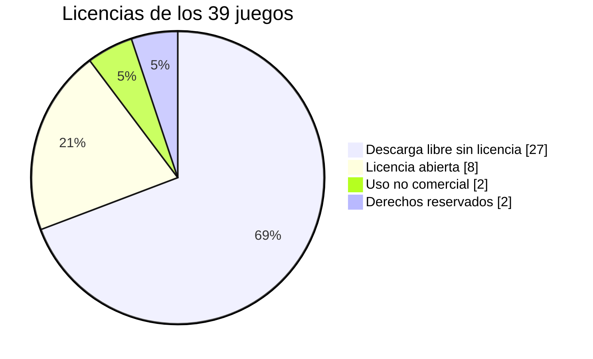

# 👾 Biblioteca de juegos de BIT-BOY

### Créditos, enlaces y licencias de las ROMs instaladas en la consola

*Todos los juegos son creaciones independientes publicadas por sus autores en itch.io.*
*Si te gusta alguno, visita su página y apoya a quien lo hizo.* 💜

**39 juegos** · 🔴 **NES 16** · 🟣 **SNES 12** · 🔵 **GBA 11**

[NES](#-nes--famicom) •
[SNES](#-snes--super-famicom) •
[GBA](#-game-boy-advance) •
[Licencias](#️-qué-significa-cada-licencia) •
[Créditos originales](#-obras-originales)

---

## 🧭 Cómo leer las tablas

| Icono | Qué indica la página del juego |
| :-: | :-- |
| 🟢 | **Licencia abierta** (MIT, WTFPL o Creative Commons) |
| 🟡 | **Uso no comercial**, sin licencia formal |
| 🔴 | **Todos los derechos reservados** |
| ⚪ | **Descarga libre**, sin licencia indicada |

---

## 🔴 NES / Famicom

| # | Juego | Archivo en la consola | Creadores | Licencia | Año |
| :-: | :-- | :-- | :-- | :-: | :-: |
| 1 | [L'Abbaye des Morts](https://parisoft.itch.io/abbaye-nes) | `Abbaye des morts` | Parisoft (port), original de Locomalito y Gryzor87 | ⚪ | — |
| 2 | [All Hell Unleashed](https://8bitslasher.itch.io/ahu) | `Ultimate Edition` | Steve (Fista Productions), Kevin81, Lilith Brendan | ⚪ | 2025 |
| 3 | [Anna: The Magic of Words](https://eastpixel.itch.io/anna) | `V0.2.2` | Christian Dinse (EASTPIXEL) | 🔴 | 2024 |
| 4 | [Böbl](https://morphcatgames.itch.io/bobl) | `1.2` | Morphcat Games (miau6502, Nicolas Betoux) | ⚪ | 2019 |
| 5 | [The Cowlitz Gamers' 2nd Adventure](https://mteegfx.itch.io/cowlitz) | `Digital` | M-Tee, Łukasz Kur, música de Robi y Chip Jockey | ⚪ | 2017 |
| 6 | [Durak](https://guyver-xbm.itch.io/durak-nes) | `ENG REV1.04` | Guyver_XBM | ⚪ | 2026 |
| 7 | [Famidash](https://kandowontu.itch.io/famidash) | `Huge Man v1.2.8` | Equipo de fans | ⚪ | — |
| 8 | [Indivisible on NES](https://kasumi.itch.io/indivisible) | `Indivisible` | Kasumi | ⚪ | 2017 |
| 9 | [Knurps Egg Rescue](https://torte00.itch.io/knurps-egg-rescue) | `V1-01` | torte00 | 🟢 MIT + CC BY-NC-SA | 2022 |
| 10 | [Light From Within](https://atarath.itch.io/light-from-within) | `Demo Rev-A` | Atarath | ⚪ | 2021* |
| 11 | [Old Towers](https://retrosouls.itch.io/old-towers-nes-famicom) | `1.1` | Denis Grachev, Oleg Nikitin | ⚪ | 2024* |
| 12 | [Oopi's Quest](https://kenney.itch.io/oopis-quest) | `1.2.0` | Kenney, música de Tedd Kerr | 🔴 | 2022 |
| 13 | [Spacegulls](https://morphcatgames.itch.io/spacegulls) | `1.1` | Morphcat Games (miau6502, Nicolas Betoux) | ⚪ | 2021* |
| 14 | [Super Bat Puncher](https://morphcatgames.itch.io/sbpdemo) | `Demo` | Morphcat Games (miau6502), música de Dave Harris | ⚪ | 2011 |
| 15 | [Super Tilt Bro.](https://sgadrat.itch.io/super-tilt-bro) | `(E)` | sgadrat | 🟢 WTFPL | 2024* |
| 16 | [Wolfling](https://lazycow.itch.io/wolfling) | `wolfling14` | Lazycow | ⚪ | — |

📝 <b>¿De qué trata cada juego de NES?</b>

 

- **L'Abbaye des Morts:** port a NES del clásico de plataformas y acertijos sobre un cátaro escondido en una iglesia.
- **All Hell Unleashed:** plataformas donde peleas contra íconos del cine de terror y reúnes fragmentos de un amuleto para cerrar un portal.
- **Anna: The Magic of Words:** plataformas de precisión con historia seria, inspirado en los arcades de los 80.
- **Böbl:** metroidvania de física en el que eres una burbuja que se mueve con agua y busca patos perdidos.
- **Cowlitz Gamers' 2nd Adventure:** plataformas cooperativo completo para dos jugadores.
- **Durak:** el juego de cartas ruso contra dos rivales de la consola. Gana quien se queda sin cartas primero; el último en tenerlas es el "tonto" (*durak*). Trae barajas de 24, 36 y 54 cartas, reglas integradas, vista de toda la baraja y un modo de práctica que muestra las cartas de los rivales. Probado en una consola real, con versión en inglés y en ruso.
- **Famidash:** recrea la mecánica de Geometry Dash en NES, con niveles de la comunidad.
- **Indivisible on NES:** Ajna recorre templos olvidados para encontrar a su tapir.
- **Knurps Egg Rescue:** juego de acertijos hecho en una game jam con NES Puzzle Maker.
- **Light From Within:** aventura de acción donde Ella intenta salvar a un espíritu que mantiene vivo su mundo.
- **Old Towers:** acción y acertijos en torres malditas, alternando entre dos héroes.
- **Oopi's Quest:** Oopi cae en un planeta desconocido y junta nueces para reparar su nave.
- **Spacegulls:** plataformas con gaviotas en el espacio. Su primera versión ganó el NESdev Compo 2020/21.
- **Super Bat Puncher:** plataformas para 1 o 2 jugadores contra murciélagos alienígenas.
- **Super Tilt Bro.:** juego de pelea al estilo Smash Bros. con modo en línea.
- **Wolfling:** plataformas donde Ling escapa de un calabozo cambiando entre forma humana y de lobo.

---

## 🟣 SNES / Super Famicom

| # | Juego | Archivo en la consola | Creadores | Licencia | Año |
| :-: | :-- | :-- | :-- | :-: | :-: |
| 1 | [Dangerous Drake](https://zelder.itch.io/dangerous-drake-snes) | `PAL` | ZeLDER | ⚪ | 2025 |
| 2 | [Der Wanderknecht](https://goldlocke.itch.io/der-wanderknecht) | `(J) v1.1` | Goldlocke | ⚪ | 2025 |
| 3 | [sNESert Golfing](https://rainwarrior.itch.io/nesert-golfing) | `dgolf` | rainwarrior, portada de Penelope Fedorko | ⚪ | — |
| 4 | [Dottie Flowers](https://goldlocke.itch.io/dottie-flowers) | `(J) v1.1` | Goldlocke | 🟡 | 2023 |
| 5 | [K-fet Invaders](https://nathbo.itch.io/k-fet-invaders-snes) | `k-fet invaders` | NathBo | ⚪ | 2025* |
| 6 | [FPS Test ROM](https://kidmarscat.itch.io/sfcfpstest) | `kmc fpstest` | kid marscat | 🟢 MIT + CC BY-NC | 2022 |
| 7 | [Mai Nurse](https://lunoka.itch.io/mai-nurse) | `v1.02` | lunoka | ⚪ | — |
| 8 | [Raptor: Call of the Shadows](https://mabaros800.itch.io/raptor-call-of-the-shadows) | `raptor-snes` | mabaros800 (port no oficial), original de Cygnus Studios / Apogee | ⚪ | — |
| 9 | [Supercooked!](https://goldlocke.itch.io/supercooked) | `(J) v1.2` | Goldlocke, BennySnesDev, ChronoMoogle | 🟡 | 2022 |
| 10 | [Super Rambler](https://torte00.itch.io/super-rambler) | `v1-01` | torte00 | 🟢 MIT + CC BY-NC-SA | 2021 |
| 11 | [Super Sudoku](https://raphnet.itch.io/super-sudoku) | `v1.0` | raphnet | ⚪ | 2019 |
| 12 | [Sure Instinct](https://bennysnesdev.itch.io/sure-instinct) | `PAL v1.0.2` | BennySnesDev | ⚪ | 2021 |

📝 <b>¿De qué trata cada juego de SNES?</b>

 

- **Dangerous Drake:** plataformas clásico hecho para el concurso SNESDEV 2025.
- **Der Wanderknecht:** plataformas en bicicleta; buscas atajos para ganar medallas de oro.
- **sNESert Golfing:** golf minimalista inspirado en Desert Golfing, para 1 a 4 jugadores.
- **Dottie Flowers:** plataformas donde hay que salvar la ciudad de Colonia.
- **K-fet Invaders:** arcade en el que aplastas enemigos para encadenar combos.
- **FPS Test ROM:** ROM de diagnóstico que mide cuánto tarda el emulador en dibujar 60 cuadros. Útil para probar la consola.
- **Mai Nurse:** acertijos estilo Dr. Mario: juntas cápsulas del mismo color para eliminar virus.
- **Raptor: Call of the Shadows:** port hecho por fans del shooter vertical de DOS de 1994. Ganas créditos para comprar armas y reparar tu nave en el hangar. Corre en un SNES normal sin chips extra y agrega cooperativo para dos jugadores, controles estilo Asteroids, selección de los 27 niveles, cuatro dificultades y mods de dinero o vida infinitos. Incluye su código fuente (v0.18).
- **Supercooked!:** juego cooperativo de cocina para hasta 4 jugadores, inspirado en Overcooked!
- **Super Rambler:** juego corto de contrarreloj, hecho para el SNESDEV Game Jam 2021.
- **Super Sudoku:** 400 sudokus, con pistas y solucionador automático.
- **Sure Instinct:** guías una bola por laberintos cambiando entre dos perspectivas.

---

## 🔵 Game Boy Advance

| # | Juego | Archivo en la consola | Creadores | Licencia | Año |
| :-: | :-- | :-- | :-- | :-: | :-: |
| 1 | [Bible PON](https://janicious.itch.io/biblepon) | `BiblePON` | Janicious | ⚪ | 2026* |
| 2 | [Buscón de Tormes](https://albafg.itch.io/life-and-adventures-of-buscon-de-tormes) | `Buscon de Tormes` | Alba, Woolf, JPC_27, SailorFu y equipo | ⚪ | 2026* |
| 3 | [bygone snow](https://creatalsoft.itch.io/bygone-snow) | `bygone snow` | Creatalsoftware Games | ⚪ | 2025 |
| 4 | [Collie Defense](https://xvayan.itch.io/collie-defense) | `collie-defense-demo` | vayan | ⚪ | 2022* |
| 5 | [Glass Eyes](https://cinemint.itch.io/glass-eyes-gba) | `GlassEyes-001` | Cinemint | ⚪ | — |
| 6 | [piuGBA](https://afska.itch.io/piugba) | `piugba.arcade.prod` | Afska | 🟢 MIT | — |
| 7 | [Space Labyrinth!](https://generic-brand.itch.io/space-labyrinth) | `(U) v1.0` | Generic Brand Systems | 🟢 CC BY-NC-ND | 2026 |
| 8 | [SpaceRocks](https://exstefen.itch.io/spacerocks) | `SpaceRocks` | ExStefen, Isaac, Csaba | 🟢 MIT (código) | 2022 |
| 9 | [Stack a Tower](https://luigiwuigi.itch.io/stack-a-tower-psx-gba) | `stacktowerV1.1` | Laluigi | ⚪ | 2026 |
| 10 | [SubQuest](https://rgamesofficial.itch.io/subquest) | `v1-0-1` | RadikalGames | ⚪ | — |
| 11 | [Voltorb's Escape](https://asemanu.itch.io/voltorbs-escape) | `Voltorb's Escape` | AceMan | 🟢 CC BY-NC-SA | 2025 |

\* Año aproximado, tomado de la bitácora, del primer demo o de la fecha de publicación.

📝 <b>¿De qué trata cada juego de GBA?</b>

 

- **Bible PON:** juego de ritmo minimalista: presionas A en el momento justo.
- **Buscón de Tormes:** metroidvania basado en el clásico del Siglo de Oro español.
- **bygone snow:** novela visual corta (unos 30 minutos) sobre la relación de dos personas.
- **Collie Defense:** tower defense para proteger a tus ovejas. Hecho para el GBA Jam 2022.
- **Glass Eyes:** aventura y RPG en beta pública, de Cinemint (autor de Cornucopia).
- **piuGBA:** simulador de Pump It Up con canciones libres de Project Outfox.
- **Space Labyrinth!:** laberinto de naves: rescatas sobrevivientes antes de que se acabe el tiempo.
- **SpaceRocks:** shooter de desplazamiento lateral al estilo Gradius y R-Type.
- **Stack a Tower:** apila bloques en 3D para hacer la torre más alta, a 30 cuadros por segundo. La versión 1.1 agrega cámara de 360° y guarda tus mejores puntajes. Sonidos de Pixabay.
- **SubQuest:** RPG derivado de la serie LightQuest: Ethan busca su mascota virtual.
- **Voltorb's Escape:** acertijos hechos por fans: un Voltorb escapa del Team Rocket.

---

## ⚖️ ¿Qué significa cada licencia?

🟢 <b>WTFPL</b> — Super Tilt Bro.

 

La licencia más permisiva que existe: se puede copiar, modificar y redistribuir sin condiciones.

🟢 <b>MIT</b> — piuGBA, SpaceRocks y el código de los juegos de torte00 y kid marscat

 

Permite usar, copiar, modificar y redistribuir, conservando el aviso de copyright y el texto
de la licencia. En SpaceRocks la licencia cubre el código.

🟢 <b>Creative Commons (CC)</b> — gráficos y música de varios juegos

 

| Sigla | Significa | Juegos |
| :-- | :-- | :-- |
| **BY** | Hay que dar crédito al autor | Todos los de abajo |
| **NC** | Sin uso comercial | FPS Test ROM, Knurps, Super Rambler, Voltorb's Escape, Space Labyrinth! |
| **SA** | Las versiones modificadas se comparten con la misma licencia | Knurps, Super Rambler, Voltorb's Escape |
| **ND** | No se permiten versiones modificadas | Space Labyrinth! |

⚪ <b>Descarga libre sin licencia</b> — la mayoría

 

Sus autores los ofrecen gratis o con "paga lo que quieras" en itch.io, pero la página no
menciona una licencia. Por eso se incluye siempre el enlace a la página original.

---

## 🎨 Obras originales

Algunos juegos son ports o están inspirados en obras de otros autores. Créditos para ellos:

| Juego en BIT-BOY | Obra original |
| :-- | :-- |
| L'Abbaye des Morts | Locomalito y Gryzor87 (2010) |
| Raptor: Call of the Shadows | Cygnus Studios / Apogee Software (1994) |
| Famidash | Geometry Dash, de RobTop Games |
| Indivisible on NES | Indivisible, de Lab Zero Games y 505 Games |
| Voltorb's Escape | Sprites de Pokémon; mecánica de Pacomix 2 (Amiga) |
| sNESert Golfing | Desert Golfing, de Justin Smith |
| Supercooked! | Overcooked!, de Ghost Town Games |

---

Gracias a todas las personas que siguen haciendo juegos nuevos para consolas clásicas. 🕹️

Datos tomados de las páginas de itch.io de cada juego en noviembre de 2026.

[⬆ Volver arriba](#-biblioteca-de-juegos-de-bit-boy) · [📖 README](README.md)

